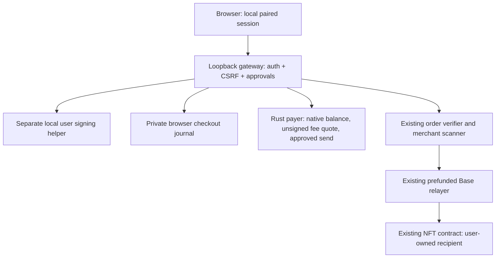
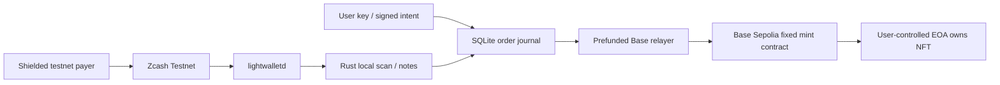

# ZecOne architecture

## Phase 1 local application boundary

The Phase 1 Next.js/React/Tailwind application is served by one custom Node gateway bound to `127.0.0.1:3210`. A local launcher exchanges a ten-minute single-use capability for a one-hour HttpOnly SameSite=Strict session. Literal Host, Origin, fetch metadata, JSON content type and session-bound CSRF checks protect a narrow API. Production CSP uses per-request script nonces; no analytics or external assets are loaded.

The authenticated browser receives an allowlisted projection, not `Store.report()`. Internal account UUIDs, merchant receiving addresses, intent signatures, raw transactions, viewing keys and full audit mappings never enter the browser response. Local data remains private/no-store. Public Base explorer links are explicit user actions.

Ownership challenges bind the origin, chain, configured user address, nonce and expiry. The helper signs only gateway-authored approval files and the gateway verifies the recovered address. Creating an order signs fixed EIP-712 mint terms; it cannot send Zcash. Sending requires a separate short-lived, session/order-bound quote. The native signer rejects fees above the approved ceiling. A durable compare-and-set and stable request UUID precede construction, so retries cannot create a new payment.

The engine serializes native work and uses the original service lock for merchant scanning/settlement. Background settlement is restricted to checkouts whose payment was explicitly approved. Restarted in-flight actions enter review; reconciliation reuses saved signatures or transaction references. Session expiry or closing the browser does not cancel already authorized work.

Native balances use `get_wallet_summary`, including shielded spendable amounts; receipt totals are never used as wallet balances. Native wallet history and known ZecOne Base mint receipts are projected separately. NFT candidates come from this verifier's settled orders and are checked with live `ownerOf`. This is deliberately not a universal NFT/transaction indexer. Collection art in the UI is a local illustration, not an on-chain image.

The process split is not a security boundary against a malicious same-OS-user program. The local operator still controls payment attestation and can correlate checkout activity. See [security review](PHASE1-SECURITY.md), [runbook](PHASE1-RUNBOOK.md), and [risks](RISKS.md).

## Preserved Phase 0 payment engine

## Boundaries

1. A local user utility holds the user's Base Sepolia EOA key and signs a fixed mint intent containing chain ID, contract, recipient, amount, nonce and expiry.
2. A local TypeScript order service verifies that signature and allocates one Zcash account/address per order through the Rust service. A SQLite transaction persists the immutable intent and unique payment destination.
3. Rust connects only to Zcash Testnet lightwalletd, synchronizes its native wallet DB, and emits locally scanned shielded output observations. Unique keys are `(txid,pool,output_index)`; accounts distinguish orders. No HTTP endpoint accepts payment claims.
4. The verifier requires complete scan coverage, sufficient confirmed value, and an unexpired order. Unconfirmed value never authorizes execution. Payments arriving after expiry, overpayments and reorgs become auditable recovery work.
5. One local worker uses an ETH-prefunded Base Sepolia key to mint a fixed ERC-721 to the signed user recipient. The contract allows one mint per order hash and validates the user's intent signature independently.

## Persistence and retries

SQLite WAL plus immediate transactions protect state transitions. A unique intent nonce prevents replay; a unique payment output key prevents double counting. Payment snapshots replace canonical observations only after successful sync. Journal entries record state transitions. Settlement progresses from awaiting payment to verified to prepared/submitted to settled. A signed raw Base transaction is persisted **before** broadcast, allowing an identical rebroadcast after crash/timeout; a transaction receipt, event and order-consumed state are reconciled before declaring settlement. Unknown broadcast results cannot justify issuing a new transaction. One worker owns a local exclusive process lock; no automatic stale-lock takeover.

Expired, underpaid, overpaid, orphaned and failed settlements remain visible. Recovery records are manual-review cases, not claims that a refund happened. A refund needs a payer-specified shielded address, ownership/context review, current canonical funds, a local shielded transaction and confirmed refund evidence. It must never race a pending Base mint. Automatic refunds are outside this slice.

## Security and ownership

No arbitrary contract calls, chain selection or calldata are accepted in an order. Only the configured Base Sepolia contract and fixed mint method are permitted. Recipient signatures bind all order terms and contract address. Contract-level replay protection survives application restarts. User key and relayer key have separate files and code paths; no server key becomes the NFT owner. Same-OS-user filesystem isolation is a development boundary, not hardened key custody.

The merchant Zcash seed is local. A separate payer seed models the paying user. For scale, migrate receiving to a viewing-key-only scanner and an isolated signing process. Testnet only; no bridge liquidity, pricing oracle or production exchange. Phase 1 adds the explicitly authorized local frontend above this unchanged settlement model.

## Phase 2 external dApp connector and restricted sponsorship

An external compatible dApp includes the public dependency-free EIP-1193 connector SDK and discovers the provider with EIP-6963 events. From an explicit user gesture, the SDK opens `/connect` on the local wallet. A random channel and the browser's exact opener origin/source bind the popup conversation. The local wallet authenticates its own session and CSRF token; that token never crosses to the dApp. The popup permits only the first validated origin and uses exact `targetOrigin` for every reply. It presents a separate origin/account/signature/transaction approval for each privileged request. This is not provider injection into unrelated websites.

Supported EVM calls pass through a restrictive policy layer and local Base Sepolia RPC. Read methods expose chain ID and the authorized public EOA only. The signer sets nonce/gas/fees, reviews exact payload, checks chain/account/nonce/value/fee limits, simulates again and signs locally. Signed raw bytes are persisted before broadcast and receipt reconciliation uses the saved hash. DApp apps/permissions live in a separate SQLite database; session, origin, request ID, payload fingerprint, expiry and review digest are stored per request. The provider has no access to Zcash APIs.

The independent test dApp lives in `test-dapp/` and runs on a distinct local origin. The ZEC sponsorship service signs a fixed typed action intent, allocates a unique payment destination and reuses the Phase 0 ten-confirmation payment worker. A separately deployed Base Sepolia contract accepts only an exact zero-value `recordFor(user, NOTE)` action after validating the signed user intent, fixed price/gas budget, expiry, chain, target and replay keys. The relayer remains separately prefunded and is not given user signing authority. Sponsorship is not a conversion or bridge. Detailed boundaries and risks are in [Phase 2 security](PHASE2-SECURITY.md), [limitations](PHASE2-LIMITATIONS.md), and [feasibility](PHASE2-FEASIBILITY.md).

## Phase 4A multichain extension

`services/evm/networks.ts` is the single allowlist for Base Sepolia (84532), Ethereum Sepolia (11155111) and Robinhood Chain Testnet (46630). Each dApp origin has its own selected testnet in the local dApp database. `wallet_switchEthereumChain` and `wallet_addEthereumChain` create approval requests; chain-add data must exactly match an allowlisted RPC, explorer and currency. Pending requests for an origin are invalidated when its chain changes. Unknown IDs and dApp-provided RPC endpoints are rejected. The user EOA signer is reused; the RPC adapter only reads and submits signed raw transactions.

`services/evm/adapter.ts` provides chain-checked health, simulation, fee/gas/nonce preparation, raw transaction chain-ID validation, receipt depth and canonical-block checks. The same public EVM address is visible on every selected chain and is linkable. `services/evm/portfolio.ts` fetches native balances from each network. ERC-20 results are deliberately empty until verified token addresses are configured; NFT ownership is checked only for the known ZecOne collections, without claiming complete indexing.

The existing Phase 3 purchase journal remains durable and now binds destination chain ID, provider, adapter and source Zcash network into new typed quotes. Reservations are accounted per chain, each RPC and deployment is selected by the allowlisted chain ID, and the existing local user signer approves the exact recipient and quote. Base continues using its preserved Phase 3 executor. Ethereum Sepolia and Robinhood use the new immutable `ZecOneMultichainExecutor`, which hardcodes its deployment chain, provider, allowed marketplace, adapter identity and test fee bounds; it pays the listed seller atomically and delivers the ERC-721 directly to the user. An independent prefunded provider pays destination gas. There is no ZEC-to-ETH swap or bridge.

Both new testnets now have funded providers and confirmed NFT, marketplace and executor deployments. Canonical deployment receipts and actual fees are saved per chain under `docs/phase4a-evidence`. Purchase completion is established independently from the real shielded payment, confirmation-at-authorization audit, destination receipt, seller payment and user NFT ownership; see [Phase 4A results](PHASE4A-RESULTS.md). Public RPC health and local Anvil/Foundry tests alone do not constitute live purchase evidence. For trust boundaries and finality limits see [Phase 4A security](PHASE4A-SECURITY.md) and [limitations](PHASE4A-LIMITATIONS.md).
