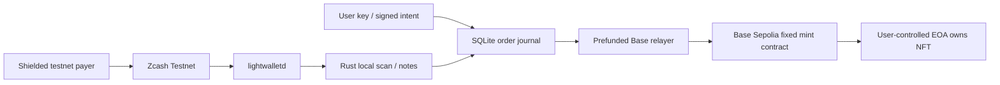

# Phase 0 architecture

## Boundaries

1. A local user utility holds the user's Base Sepolia EOA key and signs a fixed mint intent containing chain ID, contract, recipient, amount, nonce and expiry.
2. A local TypeScript order service verifies that signature and allocates one Zcash account/address per order through the Rust service. A SQLite transaction persists the immutable intent and unique payment destination.
3. Rust connects only to Zcash Testnet lightwalletd, synchronizes its native wallet DB, and emits locally scanned shielded output observations. Unique keys are `(txid,pool,output_index)`; accounts distinguish orders. No HTTP endpoint accepts payment claims.
4. The verifier requires complete scan coverage, sufficient confirmed value, and an unexpired order. Unconfirmed value never authorizes execution. Payments arriving after expiry, overpayments and reorgs become auditable recovery work.
5. One local worker uses an ETH-prefunded Base Sepolia key to mint a fixed ERC-721 to the signed user recipient. The contract allows one mint per order hash and validates the user's intent signature independently.

## Persistence and retries

SQLite WAL plus immediate transactions protect state transitions. A unique intent nonce prevents replay; a unique payment output key prevents double counting. Payment snapshots replace canonical observations only after successful sync. Journal entries record state transitions. Settlement progresses from awaiting payment to verified to prepared/submitted to settled. A signed raw Base transaction is persisted **before** broadcast, allowing an identical rebroadcast after crash/timeout; a transaction receipt, event and order-consumed state are reconciled before declaring settlement. Unknown broadcast results cannot justify issuing a new transaction. One worker owns a local exclusive process lock; no automatic stale-lock takeover.

Expired, underpaid, overpaid, orphaned and failed settlements remain visible. Recovery records are manual-review cases, not claims that a refund happened. A refund needs a payer-specified shielded address, ownership/context review, current canonical funds, a local shielded transaction and confirmed refund evidence. It must never race a pending Base mint. Automatic refunds are outside this slice.

## Security and ownership

No arbitrary contract calls, chain selection or calldata are accepted in an order. Only the configured Base Sepolia contract and fixed mint method are permitted. Recipient signatures bind all order terms and contract address. Contract-level replay protection survives application restarts. User key and relayer key have separate files and code paths; no server key becomes the NFT owner. Same-OS-user filesystem isolation is a development boundary, not hardened key custody.

The merchant Zcash seed is local. A separate payer seed models the paying user. For scale, migrate receiving to a viewing-key-only scanner and an isolated signing process. Testnet only; no frontend, bridge liquidity, pricing oracle or production exchange.
