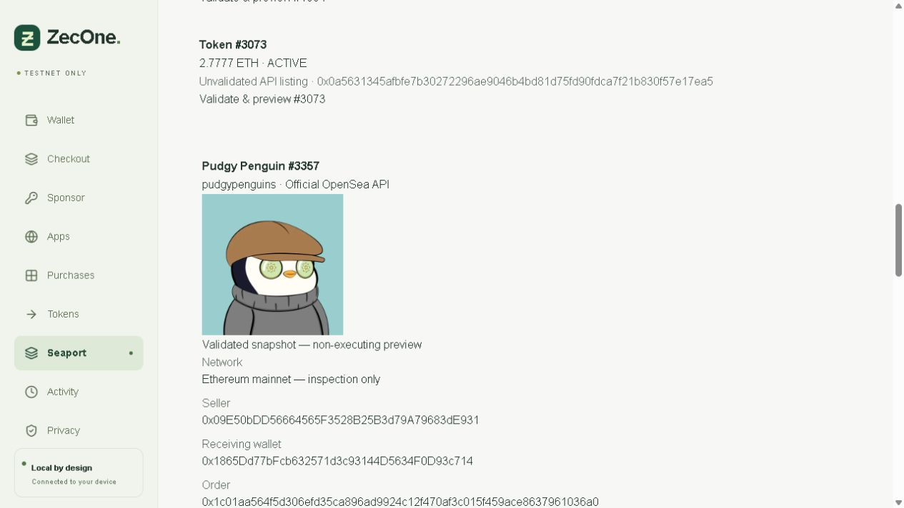

# Phase 4D results

Completed 2026-10-13. **Definition of success B is demonstrated:** ZecOne retrieved a genuine OpenSea listing through the authenticated official API, independently validated its supported Seaport order against Ethereum, simulated recipient-directed fulfillment, and displayed a non-executing shielded-ZEC checkout preview in the real local wallet. **Path A remains unproven.** No mainnet transaction, new Zcash payment, listing publication, offer or approval was broadcast. Phase 5 has not begun.

## 1. Proven against external infrastructure

Official API key issuance succeeded under the user's explicit authorization; the local credential expires 2026-10-20. Authenticated chain discovery, collection listings, individual order, collection fee metadata, NFT metadata/image and fulfillment preparation succeeded. The real browser wallet used those server-side APIs; it did not display mocked listing responses.

| Item | Verified snapshot |
| --- | --- |
| Collection / token | Pudgy Penguins / #3357, Ethereum mainnet inspection only |
| NFT contract | `0xBd3531dA5CF5857e7CfAA92426877b022e612cf8` |
| Seaport order | `0x1c01aa564f5d306efd35ca896ad9924c12f470af3c015f459ace8637961036a0` |
| Seller | `0x09E50bDD56664565F3528B25B3d79A79683dE931` |
| Intended recipient | `0x1865Dd77bFcb632571d3c93144D5634F0D93c714`, existing locally controlled user wallet |
| Price | 2.29999 ETH: 2.2769901 seller consideration + 0.0229999 required fee |
| Fee recipient | `0x0000a26b00c1F0DF003000390027140000fAa719`; collection API reports 1% required |
| Optional creator fee | 5%, not included; no extra fee/tip added |
| CLI verification block | 26,183,087, `0xae2bb71e247a4d135cae0c5762882b1c2c41122496ebb79eddf76af95295e291` |
| Gas estimate | 188,748; reserve 0.000134122901887858 ETH at that observation |
| Hypothetical liquidity | 2.300124122901887858 ETH; not reserved or funded |
| Illustrative ZEC amount | 115.00620615 TAZ at the simulated 1 TAZ = 0.02 ETH rate; native Zcash fee unquoted |
| Simulation | Exact reconstructed `fulfillAdvancedOrder` returned true using only a hypothetical provider ETH balance override |
| Real UI verification | Later block 26,183,105; gas reserve 0.000128304669054936 ETH, hence a slightly different illustrative amount |

These are dated observations, not a current offer or payable quote. Previews expire within five minutes; this report remains historical evidence after expiry. The simulation did not acquire the NFT or debit either wallet. The existing testnet wrapper cannot execute this mainnet order.

Checks covered chain, canonical Seaport runtime/version/domain, authoritative hash/counter/status, EIP-712 seller signature, NFT ownership and approval, controller-derived conduit/runtime/open channel, fixed consideration, collection fee metadata, explicit recipient, exact API/reconstructed calldata and attribution. RPC state reads used a single block, followed by a canonical-block recheck. Contract consideration recipients are displayed and simulated, not treated as audited safe recipients.

Evidence: [actual API catalog](phase4d-evidence/api-catalog.json), [full non-executing preview](phase4d-evidence/live-preview.json), [protocol identity](phase4d-evidence/protocol-identity.json), [real UI text](phase4d-evidence/live-wallet-preview.txt), [full UI screenshot](phase4d-evidence/live-wallet-preview.png), [preview screenshot](phase4d-evidence/live-preview-summary.png). The image came through the permitted OpenSea image CDN and was embedded as raster data; the browser receives no API key.

## 2. Tested locally

Minimal MV3 extension source exposes EIP-6963 on exact OpenSea origins. It carries no keys, background worker, localhost fetch permission or privileged signer bridge. Browser-authenticated popup origin/source/channel, local session/CSRF and explicit approval remain the signing authority. Injection itself grants no authority.

**207 tests pass:** 139 Node/Anvil, 52 unchanged Solidity, four unchanged Rust, 12 browser tests. This preserves all 168 prior tests and adds 37 Node tests plus two browser tests. [Node](phase4d-evidence/node-tests.txt), [Solidity baseline](phase4d-evidence/baseline-contracts.txt), [Rust baseline](phase4d-evidence/baseline-rust.txt), [browser](phase4d-evidence/browser-tests.txt). Both [service](phase4d-evidence/typecheck.txt) and [web](phase4d-evidence/typecheck-web.txt) typechecks and the [production build](phase4d-evidence/wallet-build.txt) pass. The initial sandbox build hit a Next output-directory permission error; the same build succeeded with approved filesystem access.

New coverage includes discovery, request correlation, origin/source spoofing, unauthorized/private RPCs, revocation/expiry/disconnection, configured network events, response limits, secret redaction, denied/expired keys, rate limits, unsupported/expired listings, changed fees/recipient/chain/calldata, exact fee policy, preview expiry and protected HTTP routes. The browser harness uses a synthetic local signer and substitutes only the source's origin allowlist for localhost; it does **not** prove installed-extension or OpenSea website compatibility.

The unchanged controlled Seaport integration tests again exercise actual protocol code on a local fork, ten-confirmation gating, seller payment, user delivery, replay protection, recovery and restart reconciliation. Synthetic payments remain labeled as fixtures.

## 3. External and environment blockers

The real OpenSea site was inspected in the available in-app browser. It displayed WalletConnect and extension wallet choices, but no ZecOne provider was installed. [Actual picker](phase4d-evidence/opensea-connect-picker.png), [more options](phase4d-evidence/opensea-wallet-options.png). The controlled browser has no supported extension installation interface; Chrome/Edge was not available through that browser-control connection. No regular browser profile or security setting was modified. Actual discovery, account access, supported signatures, switching and revocation on OpenSea therefore remain untested.

The public chains response does not establish testnet API listing availability. Mainnet read-only inspection is intentionally separate from testnet execution. A registered WalletConnect relay project ID/session implementation is absent.

## 4. Not implemented

Production purchasing, mainnet signing/approvals, listing/offer creation, arbitrary Seaport execution, WalletConnect, automatic refunds, a production exchange/bridge and Phase 5. Read-only support is Ethereum, fixed native-ETH, full-open single ERC-721 orders under the documented policy. No ERC-1155, criteria, bundles, restricted zones, partial fills, dynamic prices, ERC-20 consideration or bulk-signature proof support.

## Preservation and prior transaction evidence

[Preservation proof](phase4d-evidence/preservation-verified.json) verifies all 199 earlier evidence/dependency files unchanged, the same three original orders plus five purchase orders, and unchanged broadcast counts (3 + 5). Existing keys, deployments, Rust pins and settlement policies are retained. Private SQLite snapshots remain local and ignored.

No new testnet payment was needed. The preserved Phase 4C payment `be203c56ae342ae368d13547b1a65f09f8912decd6bf2e7fd18aaf7071ff8bdf` authorized settlement at 13 confirmations. The [real Base Sepolia fulfillment](https://sepolia.basescan.org/tx/0x473e5fe828041b87b7efb9a8099534840128f00dc7713e5662c79fb00ab511e4), exact seller proceeds, user delivery, one broadcast and restart proof remain in [Phase 4C results](PHASE4C-RESULTS.md). This is historical live evidence plus current deterministic regression, not a new Phase 4D payment.

An interrupted native scan left a lock owned by nonexistent PID 9984. Before archiving only that exact lock, a read-only journal audit found eight mined sends and one previously verified expired/unmined send; all eight application orders were already settled. The lock is retained in the private checkpoint. No send marker was cleared or transaction replaced. [Journal audit](phase4d-evidence/native-journal-check.json), [recovery action](phase4d-evidence/lock-recovery.json).

The provider remains trusted and prefunded; pricing is simulated, recovery/refunds are manual, and public EVM activity is linkable. This is not a production-ready OpenSea wallet.
