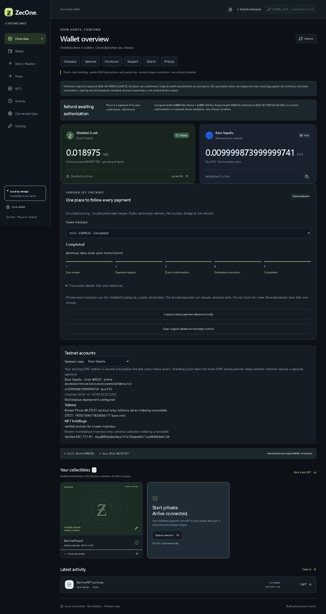

# Phase 6C product QA

15 October 2026. **PARTIAL overall.** Real historical-data rendering and local safety regressions are verified; third-party website connections remain blocked. No new transaction, ZEC payment, refund signature or broadcast occurred. No Phase 7 work began.

Continued 16 October 2026: refreshed public RPC evidence and repeated local snapshot QA after the interrupted run. The disposable snapshot/report had torn writes; exports now flush a temporary file before atomic replacement. Original preservation hashes still match. Capture dates in each evidence file distinguish the original regression run from this follow-up.

## Scope and provenance

The normal `wallet:start` server was deliberately not started: it starts synchronization, lifecycle recovery and settlement workers against historical records. Instead, `phase6c:snapshot` copies SQLite databases and their WAL/SHM companions into a new UUID directory under `.state/phase6c/snapshots`. It hashes source/copy bytes, rejects concurrent changes, and refuses overwriting destination files. Existing seeds, keys and quarantine markers are not copied or modified. The native `snapshot-summary` command accepts only a seed-free copied database beneath that snapshot directory and opens it read-only, without initialization, migration or network synchronization.

Historical views reuse existing adapter projection methods without invoking migrating/recovery constructors. SQLite read-only mode also rejects accidental writes. Copies and pairing/session state remain gitignored. The viewer serves the existing wallet UI on loopback with origin validation, one-use pairing, HttpOnly/SameSite cookies, CSRF checks, CSP and frame restrictions. A read-only session explicitly **does not prove account ownership**. App grants are copied historical metadata, not active transport sessions. All mutation routes except pairing/logout return 403; no engine, transaction worker or signer is instantiated.

## Actual wallet data

See the machine-readable [real-data export](phase6c-evidence/real-data.json) for precise capture timestamps, quantities, receipt status and public transaction references. These are point-in-time reads, not a continuously synchronized wallet.

- **VERIFIED LOCAL:** copied quarantined Zcash wallet has 1,897,500 zatoshis (0.018975 TAZ), ten history entries, tip/scanned height 4,498,492. That scan is stale. The UI labels it historical and spending disabled; SDK spendable calculations do not clear quarantine or establish current availability. Pending and expired history remains distinguished from mined transactions.
- **VERIFIED LIVE, read-only RPC:** Base Sepolia reports 9,999,873,999,999,741 wei for the user account and 19,550,169,617,820,656,117 ZTEST base units (18 decimals). Known marketplace NFT #1 is owned by the user on each configured testnet. The original mint collection is queried separately. Arbitrary asset indexing is unavailable; no invented holdings are supplied.
- **VERIFIED LIVE, read-only RPC:** Ethereum Sepolia and Robinhood testnet return zero native wei for the user account. This is separate from backend settlement-wallet funding. Base and Robinhood historical receipts re-verify successfully. The historical Ethereum Sepolia purchase receipt was not re-verified (RPC returned no depth-qualified receipt); its journal remains historical evidence rather than a fresh receipt assertion. No retry or record modification follows from this.
- **VERIFIED LOCAL:** nine historical unified checkouts include mint, action, marketplace purchases on all three configured testnets, Base swap and controlled Seaport fulfillment. Stored quote/payment/destination references are preserved. Two expired unpaid quotes remain expired. The UI does not create or pay a new order for replay.
- **VERIFIED LOCAL:** archived Phase 5.2 payment `620bdb644efcb47559e98ebf553eab07ea04ad0179b5361cdd549b8f8a2fafac` remains intact. Its archived settlement observation recorded 49 confirmations, not a fresh scan in this phase. The 90,000-zatoshi refund draft plus 10,000-zatoshi fee still hashes to `430b014672ee9e338e2154ecd02e1fcffba1ce932785530048820781894d0cbf`. It remains an unsigned, unauthorized archived draft with expiry height 4,504,159. It is not a refund transaction or an indefinitely valid authorization. [Original results](PHASE5-2-RESULTS.md).

## Product and security checks

**VERIFIED LOCAL:** Edge Chromium 155.0.4283.45, headless local development QA, existing production Next build. These are not dedicated-profile or real-dApp tests. [Browser metadata](phase6c-evidence/local-browser.json).

Six tests run against the real snapshot API without route mocks: 1440×1000 desktop, 900×1000 narrow window, 390×844 mobile, saved mint/purchase/swap/Seaport transaction replay with refresh/selection persistence, rejection of refresh/payment/approval/refund mutation attempts, and network loss/reconnection. Viewport tests check no horizontal overflow and WCAG 2 A/AA axe violations. The expired-history contrast failure found in the first run was fixed; it now passes. These automated checks do not establish exhaustive manual accessibility compliance. [Real UI log](phase6c-evidence/real-ui.txt).



[Narrow screenshot](phase6c-evidence/real-narrow.png), [mobile screenshot](phase6c-evidence/real-mobile.png), [historical checkout screenshot](phase6c-evidence/real-checkout.png). No synthetic assets are substituted into these images.

Existing 20 UI fixtures additionally cover keyboard navigation, native approval focus trapping, exact-term/fee separation, stale or malformed RPC data, failed payments, OpenSea non-executing previews, navigation and payment idempotency. Existing 14 installed-extension fixture tests cover malicious origins and forged responses, account permissions, supported chain switching, mainnet rejection, revocation, browser restart and worker termination. They use isolated synthetic sites/signers. [UI log](phase6c-evidence/ui-final.txt), [extension log](phase6c-evidence/extension-final.txt).

Seven new Node tests cover standard/legacy personal-sign ordering and account mismatch, unlimited/all-NFT approval warnings, provider coexistence/duplicate listeners, rejection-only approvals, source-copy preservation/read-only database enforcement, transaction simulation/gas/duplicate/replay behavior, and authenticated mutation denial. A new native regression rejects an original wallet path before opening it. [Focused log](phase6c-evidence/phase6c-tests.txt), [native watch tests](phase6c-evidence/watch-tests.txt).

Expired orders, underpayments, duplicate payments, retries, failed settlement, recovery vetoes and independent refund authorization retain their existing full-suite tests. Failure fixtures are synthetic and never reported as real payments. Historical replay does not generate a new live quote, display a newly payable shielded address, execute a destination action or authorize a refund. Those active workflows remain out of scope for this no-broadcast phase.

## Verification

Baseline: 325 passing tests (223 Node, 20 UI, 14 installed-extension, 52 Solidity, 8 native wallet, 4 watch, 4 native signer). Baseline production build passed.

Final: **339 passing tests** (230 Node, 20 UI, 14 installed-extension, 6 real-data UI, 52 Solidity, 8 wallet, 5 watch, 4 signer). One standalone expensive signer proof test remains ignored by its existing Rust configuration; the Node integration suite exercises isolated native proof/extraction. This is not an extra unrun live test.

Logs: [Node](phase6c-evidence/node-final.txt), [contracts](phase6c-evidence/contracts.txt), [native wallet](phase6c-evidence/baseline-wallet.txt), [native signer](phase6c-evidence/baseline-signer.txt), [typecheck](phase6c-evidence/types.txt), [web typecheck](phase6c-evidence/types-web.txt), [lint](phase6c-evidence/lint.txt), [production build](phase6c-evidence/build.txt). No dependencies or SDK versions were upgraded. Foundry's non-fatal signature-cache write warning did not fail contract tests.

The [preservation audit](phase6c-evidence/preservation.json) compares the pre-existing private inventory, without resetting its baseline: 537 protected files must match. This includes historical credentials, quarantined records and Phase 5.2 evidence. The unsigned PCZT hash is also checked during export. Same-computer local storage is not separate-device isolation; live refunds remain disabled.

## Reproduce safely on this Windows workspace

Use the installed pinned dependencies and Rust toolchain. These commands do not invoke the normal wallet backend:

```powershell
$env:CARGO_TARGET_DIR = Join-Path (Get-Location) 'target'
$env:CARGO_INCREMENTAL = '0'
cargo build --locked --offline --manifest-path services/zcash-watch/Cargo.toml
npm run phase6c:snapshot
npm run wallet:build
npm run test:phase6c
node scripts/phase6c-preserve.mjs
```

The snapshot command needs the existing historical databases/public deployment configuration, and network access only for public EVM reads. It never obtains secrets from an external service. RPC failures are recorded as unavailable, not zero balances. The original Zcash database is copied, never synchronized. Stop any legitimate writers first; if copying detects a change, it aborts instead of presenting an inconsistent snapshot. A fresh clone without the private historical data cannot reproduce this particular user's records.

For manual inspection run `npm run phase6c:viewer`, open `http://127.0.0.1:3210`, and use the token from the local gitignored `.state/phase6c/pairing.json` in the existing unlock form. Do not post that token in chat or commit it. It expires after ten minutes and is consumed once; restart the viewer to issue another. Do not run the normal launcher or `wallet:start` for this read-only exercise. The viewer locks through the existing logout button and can then be stopped with Ctrl+C.

For full regression validation run `npm test`, `npm run test:ui`, `npm run test:extension`, both typechecks, `npm run lint`, `forge test`, and the three locked/offline Rust test manifests. Run native signer compilation and native integration proof tests sequentially on Windows to avoid executable file locks. No test requires funded wallets or live refunds.

## Outstanding

**BLOCKED:** new live website wallet connection, real-site transaction/signature routing and dedicated-profile manual QA. See [exact browser blockers and per-site matrix](PHASE6C-LIVE-DAPP-VALIDATION.md). **PARTIAL:** fresh Zcash synchronization and fresh Ethereum purchase receipt verification. **NOT TESTED:** live payments, new quotes/execution and refunds, deliberately prohibited here. Do not mark Phase 6C fully complete or advance to Phase 7 on these results.
