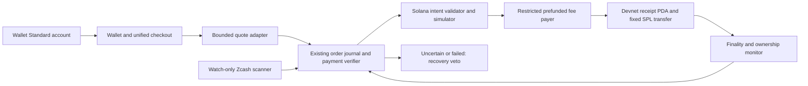

# Solana integration plan

15 October 2026. Design only. No Solana key generation, SDK installation, deployment, signatures, paid RPC subscription or live settlement in Phase 6.

## First Phase 7 integration

Build **one allowlisted legacy SPL-token devnet delivery to a user-controlled ATA**, after a verified Zcash payment. Begin with read-only SOL/token balances and Wallet Standard connection, then simulation and an explicit transaction review. Add a reviewed onchain order-receipt PDA before enabling retriable relayer settlement. Swaps, Token-2022 hooks, NFTs and mainnet are later milestones, not prerequisites for the first controlled slice.

The family discriminator must be `solana`, not an EVM chain ID. Bind cluster genesis hash, token program, mint, owner, destination ATA, quantity, fee/rent ceilings, expiry policy and unique order ID in the immutable intent. The Solana adapter implements the existing validation/quote/simulation/prepare/broadcast/reconcile boundaries. It cannot consume arbitrary dApp instruction arrays for sponsored execution.

## Provider and dependencies

Implement Wallet Standard discovery and `standard:connect`, `standard:disconnect`, `standard:events`, then explicitly reviewed `solana:signTransaction`, `solana:signAndSendTransaction` and `solana:signMessage`. Negotiate supported transaction versions per connected account; start with the version actually tested rather than assuming support for newer formats. EIP-1193 is not a Solana provider. [Wallet Standard Solana specification](https://github.com/wallet-standard/wallet-standard/blob/master/extensions/solana.md).

Recommend `@solana/kit` for typed RPC, transaction messages and signing boundaries; the maintained Anza repository and Solana examples use it. Use `@solana-program/token` for the first legacy SPL slice. Evaluate `@solana-program/token-2022` only after extension parsing/rejection rules are tested. Use matching `@wallet-standard/*` and `@solana/wallet-standard-*` packages for browser discovery. Resolve and pin an exact tested package set in Phase 7's separate branch; **no package version is claimed installed or validated here**. Avoid mixing legacy web3.js transaction objects and Kit messages without an explicit conversion boundary. [Kit repository](https://github.com/anza-xyz/kit), [official token-account examples](https://solana.com/docs/tokens/basics/create-token-account).

For NFTs, evaluate `@metaplex-foundation/mpl-core`, `@metaplex-foundation/umi` and `umi-bundle-defaults` as a separate adapter. Core stores owner directly in an asset account; it is not an SPL NFT plus ATA. Fetch asset/collection and inspect plugins before transfer; verify owner after finality. Legacy Token Metadata and compressed assets need their own decoding and indexing rules. [Core model](https://developers.metaplex.com/core/what-is-an-asset), [transfer guide](https://developers.metaplex.com/core/transfer).

## RPC, simulation, fees and finality

Use `https://api.devnet.solana.com` and its WebSocket equivalent initially. Record `getGenesisHash` and reject other clusters. Public RPC is shared and may throttle or block requests; a second independently operated devnet source should corroborate critical receipts. A dedicated provider/DAS endpoint may later require credentials and a paid tier; none is purchased now. DAS is not a standard RPC capability and is needed for scalable indexed NFT views. [RPC and commitments](https://solana.com/docs/rpc), [Metaplex asset fetching](https://developers.metaplex.com/core/fetch).

Simulate the exact message with explicit commitment and inspect errors, units, account deltas and invoked programs. Resolve every address-lookup-table entry before review; reject unknown programs, extra writable/signing accounts, unexpected closes/delegates and hidden instructions. Simulation can succeed before state changes and cannot prove transaction safety. [simulateTransaction reference](https://solana.com/docs/rpc/http/simulatetransaction).

A distinct fee payer can sponsor SOL fees while an asset owner signs required authority. The server must validate the final message after all signers: adding/changing fee-payer, recipient or compute-budget instructions changes what is signed. Require bounded compute-unit price/limit and balance/rent reservations. [Fee abstraction](https://solana.com/docs/payments/send-payments/payment-processing/fee-abstraction).

Current documented base fee is 5,000 lamports per signature, plus priority fee; failed transactions can still charge fees. A legacy ATA's documented storage balance is about 0.00203928 SOL, but query `getMinimumBalanceForRentExemption` using the actual account size and include it in the review. Devnet assets have no cash redemption value. For a first disposable exercise, propose 0.05 devnet SOL as a buffer, then recalculate from simulation rather than treating it as a fixed requirement. Engineering estimates: 2 days connection/reads, 2–3 days bounded delivery/simulation, 2–3 days receipt-program/recovery tests, then review. These are internal estimates. [Fees](https://solana.com/docs/core/fees/fee-structure), [ATA creation and cost](https://solana.com/docs/tokens/basics/create-token-account).

Persist signed bytes, signature, blockhash, last-valid block height, intent digest and construction/broadcast claims before submission. Query signature status and block height; require `finalized`, `err === null`, the exact transaction effects and expected owner/mint/amount. A processed response is not settlement. Never replace a blockhash and re-sign an uncertain transfer automatically. A memo identifies an order but does **not** prevent replay: the receipt PDA and transfer must be atomic. Durable nonce accounts introduce separate authority/race handling; exclude them from the first adapter. [Confirmation and expiration](https://solana.com/developers/cookbook/transactions/confirmation).

## Swaps, tokens and privacy

Jupiter's current official interface is Swap API v2: assembled transaction or raw-instruction routes. We did not establish a usable devnet route/liquidity service and must not assume one. Do not pass API-returned transactions directly to a relayer signer: decode programs/accounts, constrain mints/recipient/amounts/fees and resimulate. API keys and service terms need review before future use. [Jupiter Swap API](https://developers.jup.ag/docs/swap).

Raydium publishes distinct devnet program addresses and TypeScript SDK guidance. For a later devnet swap, pin the documented program ID and create a controlled pool with known mints/liquidity; program deployment alone does not establish an executable quote. Check reserves, token decimals, transfer fees, callbacks, slippage, deadlines and owner deltas. [Canonical address reference](https://docs.raydium.io/reference/program-addresses.md), [SDK documentation](https://docs.raydium.io/sdk-api/typescript-sdk.md).

Reject Token-2022 extensions by default. Transfer hooks, fees, permanent delegates, freezing and confidential state all affect delivery/quote assumptions. ATAs derive from wallet, mint and token-program ID; using the wrong program can target a different account. [ATA semantics](https://solana.com/docs/tokens/basics/create-token-account).

Confidential Balances encrypt balances/amounts, while accounts, owners, mints and counterparties remain public. Owner-derived encryption keys and client proofs are required; auditor configuration may reveal amounts to an auditor. This does not make Jupiter routes or NFT ownership private. Treat activation/proof-program availability as a per-cluster preflight and explicitly detect encrypted balances without displaying zero. [Official integration guide](https://solana.com/docs/tokens/extensions/confidential-transfer/integration-guide).

## Acceptance tests and milestones

1. Read-only account connection: discovery, rejection, disconnect, account/cluster change; no signature for balance viewing. Test wrong genesis hash, throttled RPC, malformed data and unavailable indexer.
2. Bounded legacy SPL transfer: independent recipient control, mint/program/ATA validation, fee sponsorship, insufficient SOL/rent, wrong decimals and unapproved instructions. No Token-2022 fallback.
3. Idempotent execution: duplicate order PDA, stale quote, construction interruption, identical HTTP retries, uncertain submission, expired blockhash and a restart before/after broadcast. A second worker cannot deliver a second transfer.
4. Finality/recovery: failed transaction, reorg or missing signature, RPC disagreement, exact effect/owner mismatch and execution/refund races. Reuse the recovery veto; live refunds stay gated until separately validated.
5. Later independent adapter: Metaplex Core transfer, then one controlled Raydium devnet swap. Jupiter only after service/network support and instruction validation are established.

Phase 7 implementation has not begun. Before any deployment or paid service, review the new dependency lock, program authorities, RPC capability and concrete testnet transaction approval.
